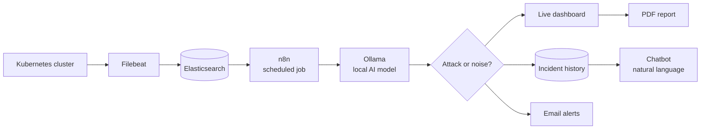

## A clinic on paper, and no one watching the system

**CIMS** is a hospital information system: doctors manage patients and appointments in one web app instead of paper files.

But the interesting part is the second problem. A real clinic runs on many small services, each with its own database. Sensitive patient data is spread everywhere, nobody has a global view, and a stolen token or a malicious request leaves **no visible trace**.

So CIMS is two projects in one: the hospital application, and a security platform that watches it from the outside and explains what it sees in plain language.

🔗 **Repo:** [github.com/ahmeddhahri100/cims_project](https://github.com/ahmeddhahri100/cims_project)

---

## Part 1 — The hospital application

Three independent services, each owning its own database:

| Service | Responsibility | Database |
|---|---|---|
| **Authentication** | Sign up, sign in, roles (`patient`, `doctor`, `admin`), issues the token the others verify | PostgreSQL |
| **Patients** | Patient records and profiles, created and updated by doctors | MongoDB |
| **Appointments** | Booking, cancelling, doctor availability, calendar view | MySQL |

A **React** front end talks to all three and ships a **bilingual (French / English)** interface.

The point of the split: no service can read another's database directly. Everything crosses a token check.

---

## Part 2 — The security platform

The easy mistake would be to sprinkle monitoring code inside the hospital services. CIMS does the opposite — the platform observes them **from the outside**, so the application stays untouched.



- **Filebeat** ships cluster logs to **Elasticsearch**.
- **n8n** pulls them on a schedule and hands them to a **local AI model (Ollama)** — nothing leaves the machine.
- The model decides whether the activity is a genuine attack, **rates the threat**, and explains what happened in normal words instead of raw log lines.
- Results land on a **live dashboard**, are stored as timestamped history, and are **emailed** as alerts.
- Incidents can be exported as a **PDF report**, and a **chatbot** answers questions about past incidents by querying the database in natural language.

---

## Part 3 — Nothing ships unchecked

Every push runs a pipeline before deploy:

- unit tests
- **Trivy** — filesystem and container image scanning
- **Semgrep** — static analysis with **6 custom rules** written for this project
- **OWASP ZAP** — web scan
- **ArgoCD** applies the Kubernetes manifests, so the running cluster always matches the repository (19 manifests).

---

## What it actually produces

- **3 services, 3 databases, one system** — PostgreSQL + MongoDB + MySQL running together and authenticating against each other.
- **Doctors register patients and manage appointments** through a bilingual interface.
- **Attacks are caught, classified and explained** by a local model, with history, email alerts and PDF reports.
- **A chatbot** answers "what happened last Tuesday?" in natural language.

### Security pipeline output

| Measured result | Value |
|---|---|
| Findings from static analysis | **21** |
| Categories | 5 — privilege escalation, root containers, missing CSRF, wildcard CORS, missing non-root user |
| Custom Semgrep rules | **6** |
| Scanners on every change | **4** |
| Kubernetes manifests | **19** |

Those 21 findings are real issues the pipeline is *supposed* to surface. The pipeline working is the result — not a clean report.

---

## Known trade-offs (written down, not hidden)

- The front end authenticates to Keycloak with a **client secret**; it should use **PKCE**, because anything in a front-end variable is visible in the browser.
- Both halves use port `8080` for Keycloak, so they can't run on the same machine at once.
- The repo contains **no real credentials** — config values are local placeholders. Real deployments supply secrets via environment variables (see `.env.example` and `secrets.example.yaml`).

---

## Layout

```text
cims_project/
├── microservice/     hospital app — 3 services + React interface
├── platform_VOC/     AI security platform — dashboard, automation, AI
└── README.md
```

Each folder has its own setup instructions.
