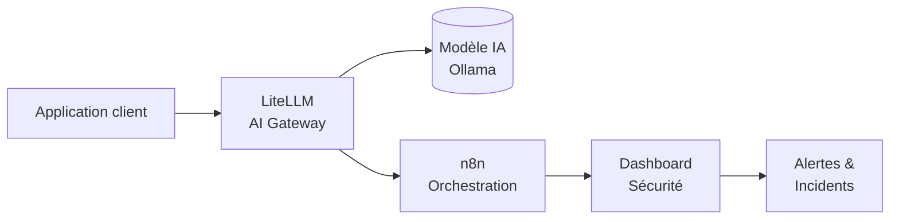

## Quand le flux IA devient lui-même une surface d'attaque

**DevSecOps & IA – PwC** est un projet qui montre qu'un workflow complet de sécurité basé sur l'Intelligence Artificielle peut être réellement construit, orchestré et observé.

Le projet intègre **LiteLLM**, une application cliente, un **dashboard de sécurité**, et **n8n**, dans le but de démontrer un flux complet **DevSecOps & IA** pour PwC.

Il est conçu pour être lancé soit via **Docker**, soit en **local** sur la machine.

🔗 **Repo:** [github.com/ahmeddhahri100/devsecopsforPwC](https://github.com/ahmeddhahri100/devsecopsforPwC)

---

## Architecture du projet

Le principe : toutes les interactions IA passent par un **point d'entrée unique** — le gateway **LiteLLM** — qui devient le cœur du flux de sécurité.



- **LiteLLM** — le gateway IA qui centralise les appels au modèle.
- **Application cliente** — interface qui interagit avec le gateway.
- **Dashboard sécurité** — visualises les flux et la sécurité des appels IA.
- **n8n** — orchestration et automatisation des workflows de sécurité.

---

## Partie 1 — Lancer LiteLLM

LiteLLM peut être lancé de deux manières :

### Option 1 : via Docker (recommandé)

La méthode la plus simple et la plus rapide pour déployer LiteLLM.

Assurez-vous d'être dans le répertoire du projet où se trouve le fichier `docker-compose.yml`.

```bash
docker-compose up -d --build
```

LiteLLM sera disponible sur :
👉 **http://localhost:4000**

### Option 2 : en local (sans Docker)

Utile si vous souhaitez lancer LiteLLM directement sur votre machine.

```bash
pip install litellm
litellm --model ollama/llama2
```

Vérifier l'accès à l'API LiteLLM :
👉 **http://localhost:4000**

⚠️ **Remarque importante :**
Pour utiliser un modèle Ollama, vous devez installer **Ollama** au préalable.

---

## Partie 2 — Lancer l'application client

Cette application permet d'interagir avec LiteLLM via une interface web.

```bash
cd prompt_Interface/
cd frontend/
npm start
```

L'application sera disponible sur :
👉 **http://localhost:3000**

Cette étape fonctionne avec LiteLLM lancé via Docker ou en local.

---

## Partie 3 — Lancer le dashboard de sécurité

Le dashboard permet de visualiser les flux et la sécurité des appels IA.

```bash
cd prompt_Interface/
cd frontend/
cd ai-flow-guard/
npm run dev
```

Dashboard disponible sur :
👉 **http://localhost:5173**

---

## Partie 4 — Lancer n8n

**n8n** est utilisé pour l'orchestration et l'automatisation des workflows.

```bash
n8n
```

Interface web de n8n :
👉 **http://localhost:5678**

Importez votre workflow dans n8n, puis exécutez-le pour orchestrer vos tâches.

---

## Tableau de bord complet

| Composant | Commande / Lancement | URL |
|---|---|---|
| **LiteLLM** | `docker-compose up -d --build` | http://localhost:4000 |
| **LiteLLM (local)** | `litellm --model ollama/llama2` | http://localhost:4000 |
| **Application client** | `npm start` | http://localhost:3000 |
| **Dashboard sécurité** | `npm run dev` | http://localhost:5173 |
| **n8n** | `n8n` | http://localhost:5678 |

---

## Ce que ce projet démontre

- Un **flux complet DevSecOps & IA** : client → LiteLLM → modèle → n8n → dashboard.
- L'IA n'est pas seulement une réponse : elle devient un **posture de sécurité** observable.
- Un **point d'entrée unique (LiteLLM)** pour toutes les requêtes IA, idéal pour la gouvernance et la surveillance.
- Une orchestration **n8n** capable de brancher le flux de sécurité, les alertes et les incidents.

---

## Conditions d'accès

- **Ollama** doit être installé pour la mode locale.
- La stack peut tourner avec **Docker** ou **sans Docker** (via pip).
- Le workflow n8n doit être importé pour activer l'orchestration.

---

## Try it

```bash
git clone git@github.com:ahmeddhahri100/devsecopsforPwC.git
cd devsecopsforPwC
docker-compose up -d --build
```

Plus d'instructions dans le [README du projet](https://github.com/ahmeddhahri100/devsecopsforPwC).
